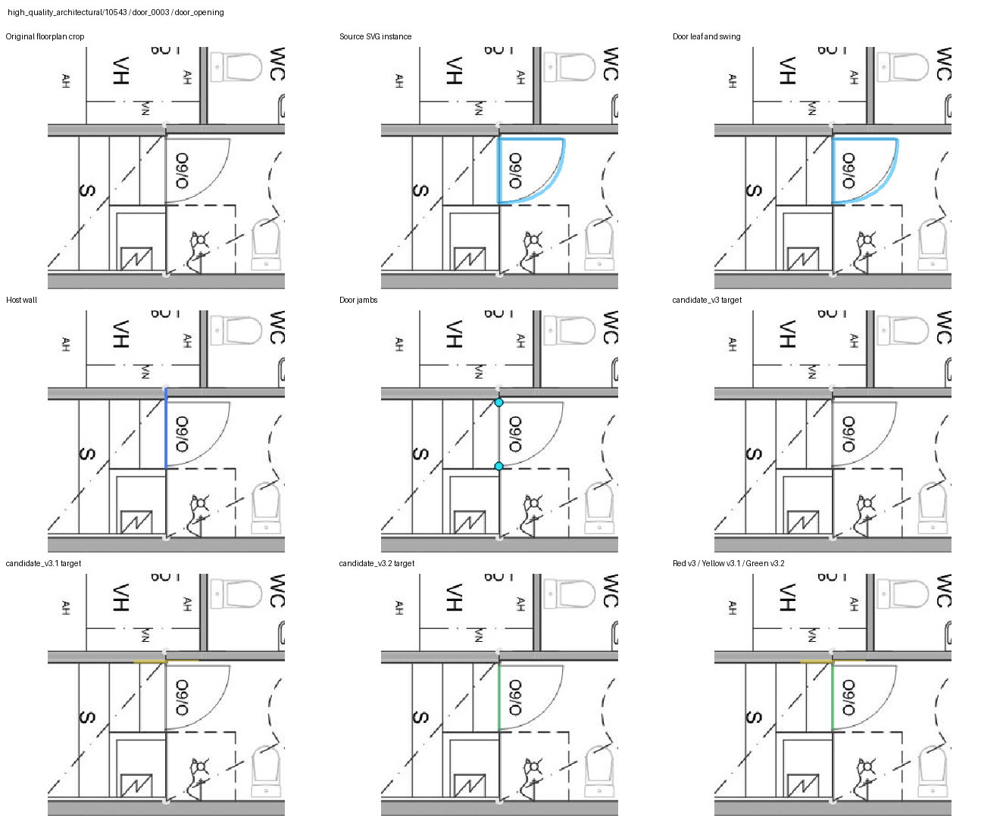
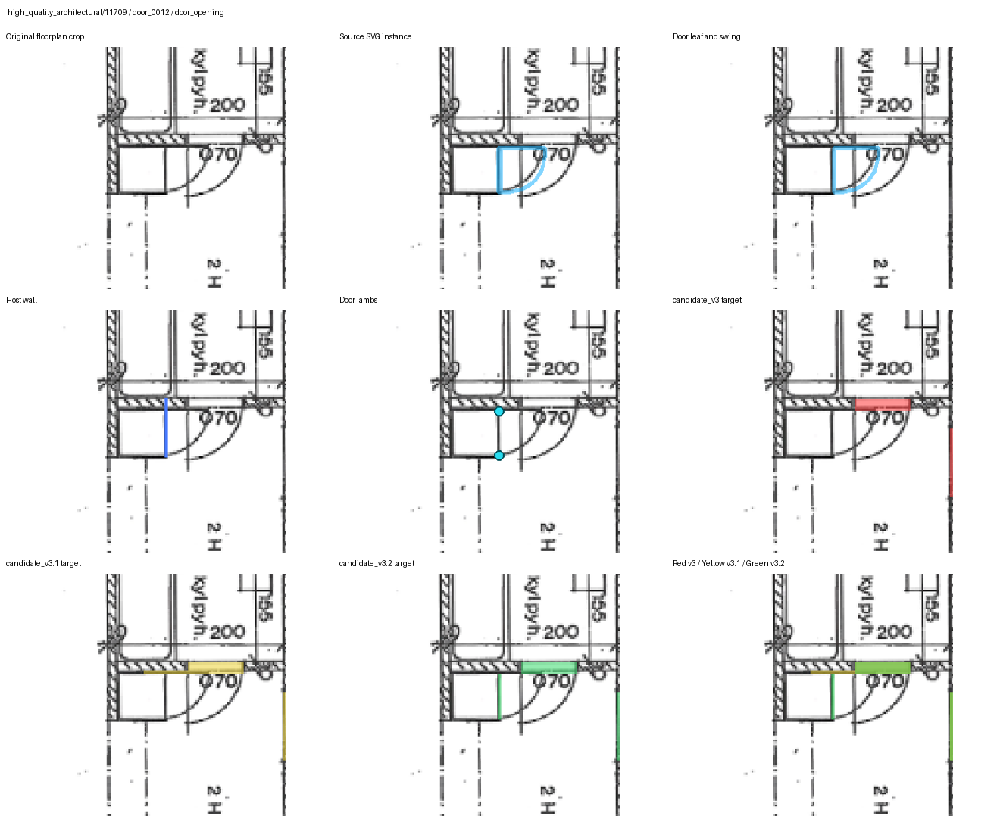
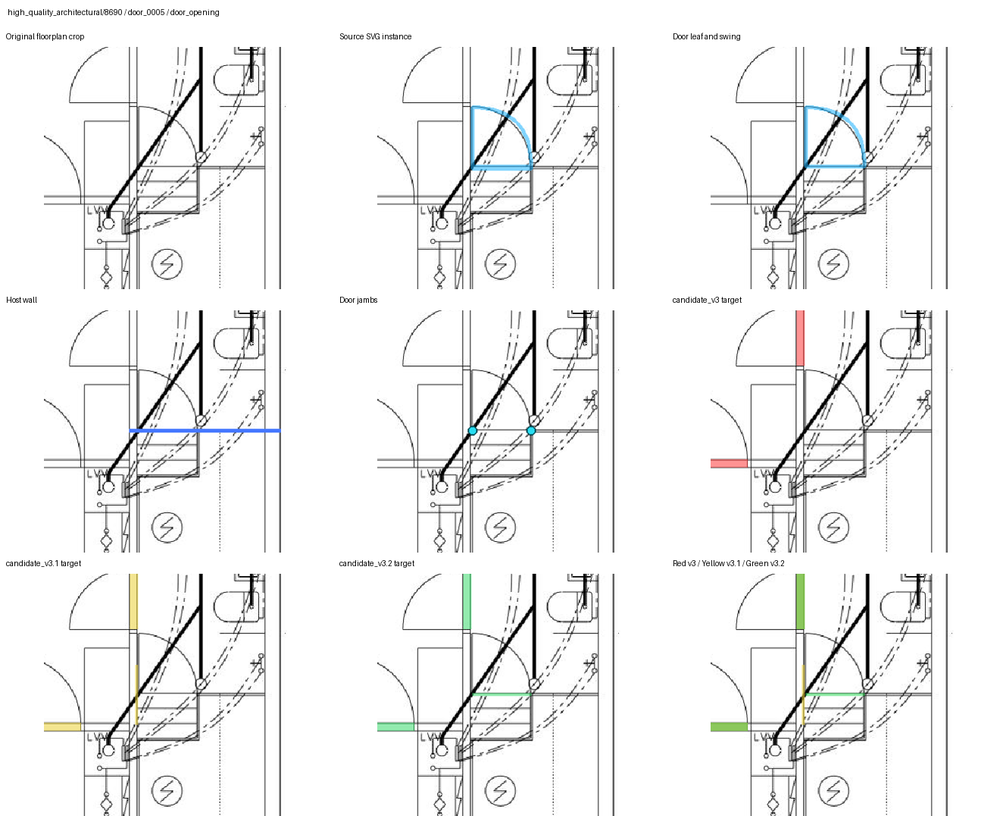

# MitUNet Phase 3A Human Review Tool

The **MitUNet Phase 3A Human Review Tool** is the AI team's local Gradio application for adjudicating target-generation evidence. It places floorplan imagery, SVG geometry, candidate masks, comparison overlays, metadata, and decision controls in one review surface while preserving every saved change as traceable evidence.

This is an **operational tooling audit**, not a model-training result. It produces no checkpoint and has no wall IoU, Dice, or object-F1 score. The related target-version model comparison remains in [experiment 10](../10_phase3a2_door_opening_v31_vs_v32_512/README.md).

The GitHub landing page is [Floor Plan AI Experiment Audit](https://github.com/pmharriscti/floorplan-ai-experiment-audit). This entry is published at [experiment 13](https://github.com/pmharriscti/floorplan-ai-experiment-audit/tree/main/experiments/13_phase3a_human_review_tool).

## What The Tool Does

| Workflow | Evidence shown | Decision output |
| --- | --- | --- |
| Opening review | Full source plan, opening crop, candidate masks, source/evidence overlay, generated before/after overlay, SVG preview, geometry metadata | Correctness, preferred target version, error categories, severity, geometry tag, reviewer, notes |
| Source-class review | Proposed source class/action plus indexed geometry and source-context sheets | Human category, action, target, confidence, status, reviewer, notes |
| Plan-target review | Source plan, legacy and candidate targets, existing overlay, generated disagreement overlay, target metadata | Review status, preferred version, error categories, severity, reviewer, notes |

Two additional tabs expose aggregate defect patterns and manifest validation. Filters can build deterministic queues by split, target, derivation method, association confidence, wall orientation, geometry ranges, review reason, status, source ID, and disagreement rank.

## AI-Team Workflow

1. Launch against explicit plan, class, and opening manifests.
2. Select a queue or apply filters appropriate to the review question.
3. Inspect source context before evaluating the mask. For opening geometry, use the source SVG instance, host-wall line, jamb markers, and axis metadata together.
4. Record a structured decision and notes. Navigation refuses to discard unsaved edits.
5. Use **Save** to change an existing decision. **Skip (undecided only)** advances without overwriting an existing verdict.
6. Use Progress and Defects to inspect category-level patterns and Validation Summary to inspect manifest shape.
7. Treat the CSV sidecars and JSONL audit log as review evidence. Human decisions remain separate from automated geometry checks and do not automatically approve a target version or experiment.

## Application Architecture

| Source module | Responsibility | SHA-256 |
| --- | --- | --- |
| `scripts/gradio_phase3a_target_review.py` | Gradio layout, controllers, navigation, save actions, launch policy | `f04f2b83beb84815609e0a2fe8043cb7f58732fbedcb8322c5324287d4ec6464` |
| `phase3a_review/manifests.py` | Manifest loading, path resolution, decision association, key validation | `136b38045c8fab651d921061c6ffae391a95e9d5857d482589635bb819ddb0d0` |
| `phase3a_review/filtering.py` | Queue construction, filters, seeded samples | `dcfd5d049eedf4b0032c6b5f919fe7eaff4d1dc60a4942bc48683ec90479d120` |
| `phase3a_review/images.py` | Masks, crops, overlays, SVG preview, pixel disagreement | `55fedf68843af967f24ce02674260465e27115db8f716c10f9ec6c87e8fd369e` |
| `phase3a_review/persistence.py` | Exact-key updates, locks, fingerprints, backups, atomic writes, audit log | `757ced4fe2765dc2e1bdd40402a49930fdd1fc63e3ba5b91d56924414fc3dfaa` |
| `phase3a_review/constants.py` | Controlled decision, error, severity, action, and status vocabularies | `acb17c842780282df17359b1457fd52020ffa559eeacc1d44bb9156a51d048e3` |
| `phase3a_review/metrics.py` | Validation, summaries, defect examples, systematic-pattern checks | `cb9866d1327cee91668aacea91bfe68f12cf5cc413a37c271baea99dd14f0b22` |

The source repository was inspected at commit `aebca12e284aa17ddef08d45327e191773e0f07a` on branch `master`. The working tree also contains unrelated modified and untracked files, so the module hashes above are the stronger identity for this audit.

## Geometry Updates Included In Phase 3A

Phase 3A is a target-generation lineage, not one geometry rule.

### `candidate_v3`: source-class and opening semantics

- Inventories the raw SVG classes before mapping them into training targets.
- Separates visual door/window symbols from the wall opening occupied by those objects.
- Associates each opening with structural-wall support and clips the opening mask to that support.
- Keeps ambiguous classes and openings reviewable instead of silently converting them into confident labels.

### `candidate_v3.1`: warning-family repairs

- **Family A:** repairs cases where door-symbol geometry had been used as the opening seed.
- **Family B:** repairs source-instance classification/localization cases, including border-collapsed geometry.
- **Family C:** repairs gap-aware host-wall association cases.

The v3.1 Family A implementation exposed an important geometry lesson: estimating a nearby wall with local PCA, synthesizing a rectangle, and snapping it to the nearest wall pixel can select a perpendicular or adjacent wall near corners, stacked doors, and image borders.

### `candidate_v3.2`: source-evidenced opening axes

- Uses the source `Door` threshold polygon and its parent `Wall` polygon as the geometry evidence.
- Estimates wall tangent with PCA/SVD, derives the normal explicitly, and compares axes modulo 180 degrees.
- Records legacy orientation separately from `v3_2_wall_tangent_angle`, `v3_2_wall_normal_angle`, and `v3_2_opening_axis_angle` so tangent/normal semantics are not hidden behind one overloaded field.
- Builds jamb-to-jamb opening support from source geometry instead of inferring a generic raster rectangle.
- Rejects mismatched nearby walls instead of speculating about an association.

The persisted Family A axis audit reports 10 of 10 repaired instances tangent-aligned, with zero normal-aligned, wrong-wall, outside-opening, ambiguous-orientation, or missing-jamb cases. The focused test suite includes horizontal, vertical, diagonal modulo-180, wrong-nearby-wall, and real-sample regression cases.

## Evidence Rendering

The opening panel combines complementary views:

- `opening_source_crop()` reads the manifest bbox and draws an opening-centered source crop.
- `image_panel()` displays source plans and binary masks while reporting unavailable files clearly.
- `comparison_overlay()` renders shared foreground white, after-added pixels green, and after-removed pixels pink.
- `mask_disagreement()` reports foreground counts, intersection, union, IoU, added/removed pixels, and change percentage.
- `svg_preview_html()` displays the original vector evidence without converting it into a training claim.
- A packaged three-way sheet can add source instance, door leaf/swing, host wall, jambs, v3, v3.1, v3.2, and a color-coded version comparison.

The live Phase 3A.2 opening manifest contains 44 evidence records: 10 focused Family A geometry cases and 34 controls across train, validation, and test. All 44 source images, source SVGs, v3 targets, and v3.2 targets resolve. Dedicated three-way sheets are packaged for the 10 Family A cases. Control rows use the app's plan-overlay and generated-comparison paths.

An evidence-path audit also found 14 control rows whose recorded v3.1 mask path is absent. Because the opening controller currently treats a non-empty path as selected before checking whether the file exists, those rows should be regenerated or have their manifest path cleared before a v3.1 comparison session. This is an evidence-packaging concern; it does not change the v3.2 geometry artifacts.

## Save And Audit Protections

- Decisions use exact composite keys; duplicate matches are refused.
- Opening and class decisions are written to sidecar CSVs, preserving automated manifest fields.
- An exclusive `fcntl` lock serializes writers.
- File fingerprints detect external changes after the app loads and refuse a conflicting save.
- A source-file backup is created once per session before mutation.
- CSV updates use a same-directory temporary file, `fsync`, and atomic `os.replace`.
- Every saved change appends a JSONL record containing timestamp, session, reviewer, record key, old/new values, app version, and Git commit.
- `--read-only` disables writes, and public Gradio sharing requires the explicit `--share` option.

## Launch

The tool is local-only by default. While the server is running, the configured address is [http://localhost:7894](http://localhost:7894).

```bash
cd /home/pmharris/dev/mitunet
RUN_DIR=/mnt/e/AI_Team/mitunet/phase3a2_opening_axis_repair/experiments/mitunet_phase3a2_opening_axis_repair_20260826_142837_UTC
PYTHONPATH=. ./.venv/bin/python scripts/gradio_phase3a_target_review.py \
  --review-manifest "$RUN_DIR/review/candidate_v3_2_plan_review_manifest.csv" \
  --class-review-manifest "$RUN_DIR/review/phase3a1_snapshot/snapshots/class_review_manifest.phase3a.csv" \
  --opening-review-manifest "$RUN_DIR/review/candidate_v3_2_family_a_re_review_manifest.csv" \
  --host 127.0.0.1 \
  --port 7894 \
  --reviewer "$USER"
```

For demonstrations or audits that must not write decisions, add `--read-only`. The launcher searches up to 20 ports from the requested port if it is occupied.

## Representative Geometry Evidence

Each image is a historical nine-panel Phase 3A.2 sheet. It shows source context and explicit geometry evidence rather than a model prediction.

### Vertical host-wall correction: `10543 / door_0003`



### Jamb-to-jamb repair: `11709 / door_0012`



### Difficult nearby-wall geometry: `8690 / door_0005`



Image provenance and interpretation are in [qa/README.md](qa/README.md). The structured tool snapshot is [results/tool_evidence_snapshot.json](results/tool_evidence_snapshot.json).

## Verification

The focused source suite passed on 2026-10-20:

```text
37 passed
```

The documented local endpoint `http://127.0.0.1:7894/` also returned HTTP `200` on 2026-10-20. A separate read-only launch selected `7895` when `7894` was already occupied, confirming the port-search behavior.

Command:

```bash
PYTHONPATH=. ./.venv/bin/pytest -q \
  tests/test_phase3a_review_core.py \
  tests/test_phase3a_review_manifest.py \
  tests/test_phase3a_review_skip_guard.py \
  tests/test_phase3a2_opening_axis_repair.py
```

Coverage includes manifest normalization, duplicate-key refusal, bbox parsing, missing-image handling, mask disagreement, deterministic filtering, backups, read-only mode, sidecar saves, concurrent-write detection, Skip protection, source-threshold geometry, tangent/normal semantics, wrong-wall rejection, and real Phase 3A.2 regressions.

## Source Locations

- Tool source: `/home/pmharris/dev/mitunet`
- Main app: `/home/pmharris/dev/mitunet/scripts/gradio_phase3a_target_review.py`
- Review modules: `/home/pmharris/dev/mitunet/mitunet_cubicasa/phase3a_review`
- Phase 3A.2 run: `/mnt/e/AI_Team/mitunet/phase3a2_opening_axis_repair/experiments/mitunet_phase3a2_opening_axis_repair_20260826_142837_UTC`
- Live review package: `<run>/review`
- Geometry generator: `/home/pmharris/dev/mitunet/scripts/run_phase3a2_opening_axis_repair.py`

The live decision CSV and audit-log content are intentionally not copied into this repository. Their path, size, and SHA-256 are recorded in [provenance.json](provenance.json), while this entry publishes only aggregate tool structure and non-personal visual evidence.
