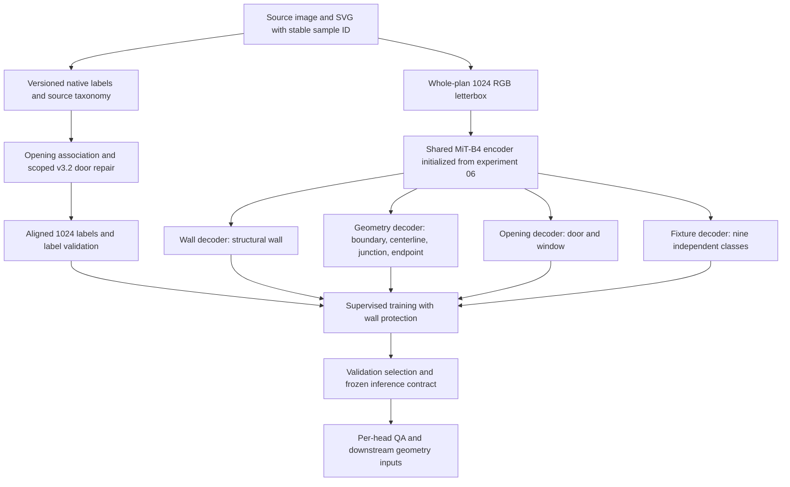
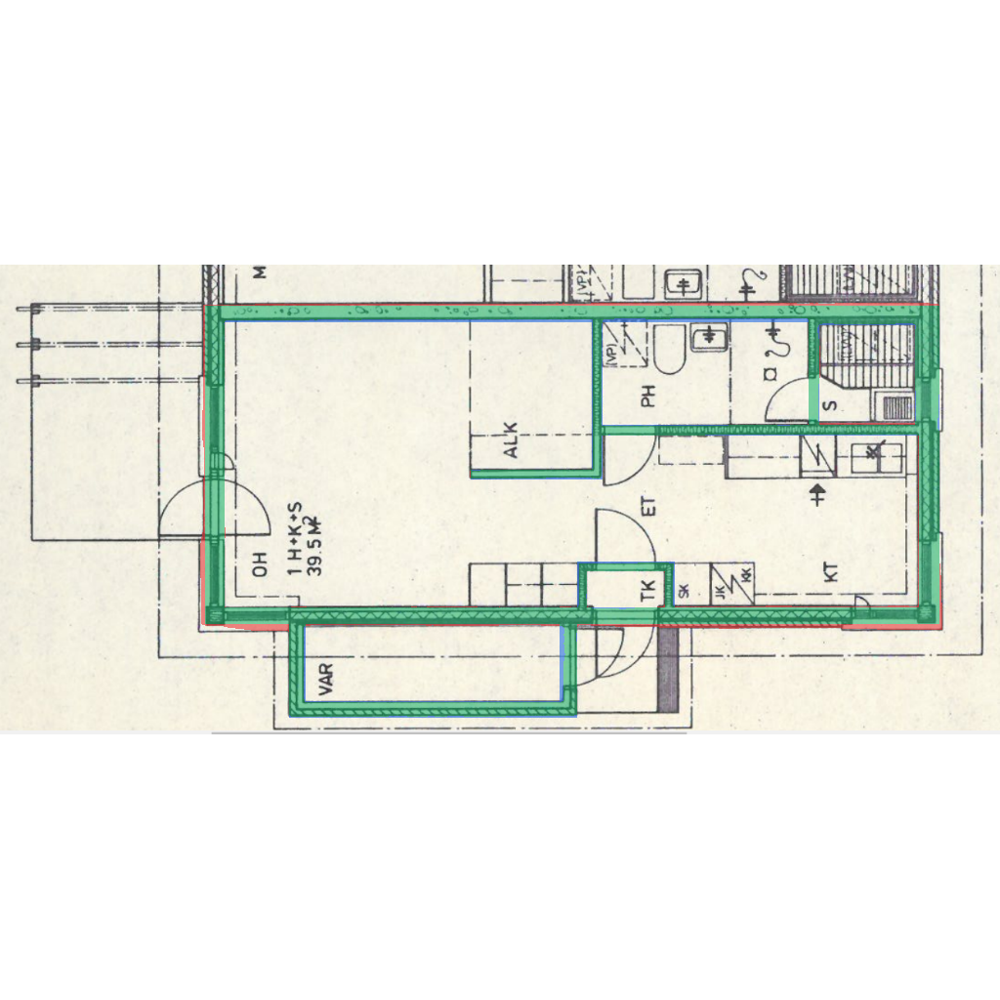
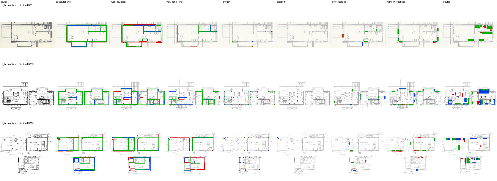

# Experiment 14: MitUNet 1024 Whole-Plan, Phase 5 Heads, Phase 3A.2 Targets

**Status: proposed configuration and execution protocol.** This entry defines the next integrated floorplan experiment. Its measured performance, training run, selected thresholds, checkpoint and resource use are still to be produced. Parent results are identified as parent evidence throughout.

The configuration combines three established lines of work:

1. **Whole-plan 1024 RGB letterboxing** and the binary-wall checkpoint from [experiment 06](../06_binary_mitunet_1024/README.md).
2. **Phase 5's shared MiT-B4 encoder, four decoder groups and eight task heads** from [experiment 09](../09_phase5_hierarchical_multihead_512/README.md).
3. **Source-supported opening labels**, including the scoped Phase 3A.2 door-axis repair, from [experiments 10](../10_phase3a2_door_opening_v31_vs_v32_512/README.md) and [13](../13_phase3a_human_review_tool/README.md).

It also incorporates the labeling improvements developed locally in `/home/pmharris/dev/mitunet` and the earlier `/home/pmharris/dev/mitunet_multihead` compiler. Their source inventory, contracts, adoption decisions and integration requirements are documented in [LABELING_IMPROVEMENTS.md](LABELING_IMPROVEMENTS.md).

GitHub: [Floor Plan AI Experiment Audit](https://github.com/pmharriscti/floorplan-ai-experiment-audit). Direct entry: [experiment 14](https://github.com/pmharriscti/floorplan-ai-experiment-audit/tree/main/experiments/14_mitunet_1024_hierarchical_phase3a2).

## Question And Intended Result

Can a whole-plan 1024 model retain the stronger 1024 structural-wall baseline while predicting boundaries, centerlines, junctions, endpoints, source-supported door/window openings and nine fixture classes?

The intended deliverable is a reproducible checkpoint plus versioned targets, class/bit definitions, per-head probabilities, selected thresholds, geometry metadata, label audits and an evaluation against the recorded controls. The scientific questions are wall retention, opening correctness and survivability, new-head utility, and compute cost.

## Reading Map

| File | Purpose |
| --- | --- |
| [config.yaml](config.yaml) | Explicit proposed settings; design specification to implement in the source workspace |
| [LABELING_IMPROVEMENTS.md](LABELING_IMPROVEMENTS.md) | Local labeling improvements, contracts, geometry rules, scope and remaining adaptation work |
| [INTEGRATION_PLAN.md](INTEGRATION_PLAN.md) | Code changes, data handoff, initialization, resource preflight and implementation checks |
| [EVALUATION_PROTOCOL.md](EVALUATION_PROTOCOL.md) | Controls, wall protection, threshold selection, coordinate conventions and acceptance evidence |
| [metrics.json](metrics.json) | Unexecuted experiment record with null measured results |
| [provenance.json](provenance.json) | Evidence sources and source identities |
| [results/parent_evidence.json](results/parent_evidence.json) | Small machine-readable parent facts, explicitly attributed |
| [source_provenance/source_inventory.json](source_provenance/source_inventory.json) | SHA-256 inventory of inspected local source files and copied contracts |
| [qa/README.md](qa/README.md) | Existing parent images and required future experiment-14 evidence |

## Evidence Behind The Design

| Audit entry | Observed result | Decision for experiment 14 |
| --- | --- | --- |
| 01: binary 512 | Test wall micro IoU `0.8244338473612428`; MiT-B4, SCSE, Adam, Tversky | Keep architecture family and structural-wall semantics; preserve historical control |
| 02: global/patch sweep | Locked selection used global weight `1.0`, patch weight `0.0` | Use a whole-plan stream |
| 03: DeepLab comparator | Lower audited wall scores than MitUNet | Keep MiT-B4/SCSE |
| 04: Phase 1 | Centerline/junction supervision added useful structure metrics | Regenerate those target families at 1024 |
| 05: Phase 2 | Added boundary/opening outputs but wall IoU regressed | Isolate the inherited wall decoder and gate checkpoint selection |
| 06: binary 1024 | Test micro IoU `0.8317579184170079`; validation micro IoU at `0.1` `0.8267843774749646` | Initialize encoder and wall path from this checkpoint |
| 07: AdamW | Zero-weight-decay AdamW lowered test IoU by `0.0038337246517485823` | Retain Adam with weight decay `0` |
| 08: native crop treatment | Crop training with 512 whole-plan validation produced best validation IoU `0.43214381550960096` | Keep whole-plan context and matching train/evaluation presentation |
| 09: Phase 5 | Eight heads met the declared wall floor; augmentation-off recipe succeeded | Carry forward grouping, losses, fixed weights, warm-up and inherited/new learning-rate groups |
| 10: target-version ablation | Source-supported v3.2 geometry repaired 10 configured Family A instances; aggregate model comparison did not establish a label-driven gain | Pin the repair scope and inspect geometry per instance |
| 11-12: IFC bridge | Predictions feed identifiable downstream geometry; coordinate/scale and review records matter | Preserve image transforms, head meaning, uncertainty and artifact identity for downstream export |
| 13: review tool | Source/SVG/mask comparison, exact-key decisions and audit history | Carry review evidence with each frozen label bundle |

These results come from different tasks and presentations. The proposed combination has its own measurements; it cannot inherit the parents' IoU or F1 as a result.

## End-To-End Design

SVGs and review records build the training/evaluation labels. Deployment predicts from the RGB drawing and the recorded image transform.

## Input And Preprocessing

- CubiCasa5K v4, `F1_scaled.png`, RGB, ImageNet mean/std.
- Preserve the official historical sample membership: train `4200`, validation `400`, test `400`.
- Match membership by stable sample ID as well as file hashes; CSV bytes and ordered-ID hashes are different identities.
- Train and validate on whole-plan `1024 x 1024` letterboxes. No patch fusion or crop sampling in the primary arm.
- Use image-linear and categorical-nearest interpolation with recorded resized dimensions, rounding and centered padding; RGB padding is white and mask padding is zero. Verify the chosen implementation agrees with the parent preprocessing.
- Disable augmentation in the initial integrated recipe. Experiment 09 established an augmentation mismatch when fine-tuning experiment 01; applying its conservative recipe to the experiment-06 parent is a proposed transfer choice.
- Rebuild every target family in the 1024 coordinate system. Existing 512 masks remain historical references; upscaling them cannot restore lost openings or original topology.

## Model And Initialization

| Decoder group | Task heads | Channels |
| --- | --- | --- |
| `wall` | `structural_wall` | 1 |
| `geometry` | `wall_boundary`, `wall_centerline`, `junction`, `endpoint` | 4 total |
| `openings` | `door_opening`, `window_opening` | 2 total |
| `fixtures` | Nine classes listed in the config | 9 |

This is eight task heads and sixteen scalar output channels, each using sigmoid-compatible supervision. Fixture classes and wall/opening concepts can overlap; the channel order must be versioned.

Load the experiment-06 checkpoint (SHA-256 `42cad015bf894e6afe11011424b7ed88c49a1512f81593f14df5b228d65a3910`) into the shared encoder, wall decoder and wall head. Copy that decoder's weights to initialize the new decoder groups, following Phase 5; initialize the additional heads as in the Phase 5 implementation. The Phase 5 checkpoint is a comparison model, rather than the primary initialization.

Before optimization, compare the inherited wall logits with the binary experiment-06 model on identical 1024 tensors, both in evaluation mode. Record all state-key/shape matches and measured numerical error. Keep the inherited modules frozen and in evaluation mode throughout heads-only warm-up.

Phase 5 records `74,468,332` parameters. The same topology should have that count at 1024, but the new build must recount parameters and buffers separately; resolution changes activation memory.

## Target Contract

| Target | Proposed source/policy |
| --- | --- |
| Structural wall | Native SVG Wall definition inherited from experiment 06, `subtract_openings: false`; prove pixel identity under its 1024 transform |
| Wall boundary | Recompute raw boundary from the 1024 structural wall; separate raw evaluation target from training band |
| Wall centerline | Recompute raw centerline at 1024; retain raw skeleton and separate training band |
| Junction/endpoint | Recompute from the selected structural-centerline graph; preserve Phase 1's corner/T/cross/multi-branch convention, point metadata and 8-connectivity |
| Door opening | Phase 3A source/wall association plus inherited repairs and scoped `candidate_v3.2` tangent/normal repair |
| Window opening | Phase 3A symbol/opening separation and wall-associated opening contract with inherited association/source-instance repairs; record this as an explicit change from Phase 5's candidate-v2 window definition |
| Fixtures | Nine explicit source-class mappings, per-class masks, stable `uint16` class-bit storage; unknown classes keep their source evidence |
| Visible wall | Derived from structural wall minus raw door/window openings; no ninth trained head |
| Door/window symbols | Separate evidence masks used by label audits and human review |

The special v3.2 axis repair applies to doors. Window-label modernization is a separate declared treatment, not evidence that the door-axis rule repairs windows. [Label details](LABELING_IMPROVEMENTS.md).

## Phase 3A.2 Geometry Configuration

The inherited generator flags are `repair_door_opening_seed_semantics`, `repair_source_instance_classification_and_localization`, and `repair_opening_host_wall_association`. Add `repair_door_opening_tangent_normal_semantics: true`, angle tolerance `15.0` degrees and the explicit Family A key list in [source_provenance/phase3a2_repair_scope.json](source_provenance/phase3a2_repair_scope.json).

Use the source Door threshold polygon and parent Wall polygon to establish tangent, normal and jamb endpoints. Compare axes modulo 180 degrees and preserve source-instance pixel provenance. Retain the legacy orientation field separately from the corrected axis fields.

The configured scope is ten instances across eight plans, with nine training instances and one validation instance. An omitted or empty instance list enables the current source helper for every matching door, so the adapter must require a nonempty explicit scope. Broader application is a separate treatment.

Native-coordinate association distances retain their source values. Training-band radii, point disks, NMS and evaluation tolerances are model-coordinate quantities and need an explicit scale policy.

## Training Recipe

| Setting | Proposed value |
| --- | --- |
| Total budget | 30 epochs: 4 heads-only, 26 joint |
| Optimizer | Adam, weight decay `0` |
| Heads-only LR | `1e-4`; inherited encoder/wall path frozen and in eval mode |
| Joint encoder/wall LR | `1e-5`, one joint epoch of linear ramp |
| Joint new-path LR | `1e-4` |
| Joint scheduler | ReduceLROnPlateau, factor `0.5`, patience `3`, validation gated score |
| Early stopping | Gated validation score, patience `8`; below-floor checkpoints remain ineligible |
| Initial physical batch | 1 |
| Accumulation | 4; nominal effective batch 4 |
| Precision/seed | AMP; first seed `42` |
| Task weighting | Explicitly `fixed` |

The existing Phase 5 runner supports accumulation. Its source YAML defaults to GradNorm despite the successful run's `--weighting fixed` override, so the new resolved configuration must select fixed weights explicitly.

Accumulation matches the nominal optimizer batch, not physical-batch normalization behavior or the exact gradient of a nonlinear batch-reduced Dice/Tversky loss. Profile one full warm-up and joint step on the chosen GPU, record normalization behavior, then freeze the batch/accumulation policy across matched arms. No 1024 multi-head VRAM or duration claim is established by the parent measurements.

## Losses And Fixed Weights

| Head | Loss inherited from Phase 5 | Task weight |
| --- | --- | ---: |
| Structural wall | Asymmetric Tversky, alpha `0.6`, beta `0.4` | 0.40 |
| Wall boundary | 0.5 BCE + 0.5 SoftDice | 0.08 |
| Centerline | 0.5 BCE + 0.5 SoftClDice, 10 iterations | 0.12 |
| Junction | Sigmoid focal BCE | 0.05 |
| Endpoint | Sigmoid focal BCE | 0.03 |
| Door opening | 0.5 sigmoid focal BCE + 0.5 SoftDice | 0.12 |
| Window opening | 0.5 sigmoid focal BCE + 0.5 SoftDice | 0.12 |
| Fixtures | Mean over nine classes of focal BCE/SoftDice | 0.08 |

Recompute positive-class statistics from the new training masks only, retaining Phase 5's weighting caps. Never use validation/test prevalence to define the loss. These are initial design choices; altered prevalence at 1024 and repaired masks may change optimization.

## Selection And Measurement

Protect the **1024 parent**, using `val structural_wall micro IoU @ 0.1 >= reproduced experiment-06 IoU - 0.005`, measured on the same validation manifest and preprocessing. The historical validation threshold-search reference is `0.8267843774749646`; if reproduced exactly, the floor is `0.8217843774749646`. The actual floor is computed from the new evaluator's reproduction. The logged best-epoch IoU and the old 512 gate are different quantities.

Keep best gated hierarchical, best wall, best ungated score, and last recovery checkpoints separately. After checkpoint selection, tune thresholds on validation only for every head/class. Parent thresholds are diagnostic seeds rather than selected experiment-14 thresholds.

Report native-1024 boundary/point metrics with explicit tolerances and a common-512 evaluation for historical comparisons. A 2-pixel boundary tolerance and 5-pixel point tolerance at 512 correspond nominally to 4 and 10 pixels at 1024; changing resolution without recording this changes the question. The detailed primary metric convention, paired arms and selection procedure are in [EVALUATION_PROTOCOL.md](EVALUATION_PROTOCOL.md).

## Local Labeling Improvements

The source work contributes conservative SVG class inventory, explicit mappings, structural/visible-wall separation, symbol/opening separation, source-supported door axes, mask-transform identity, per-instance resize survivability, topology lineage, fixture-class encoding, mechanical/semantic validation, and auditable human decisions.

The earlier `mitunet_multihead` compiler also contains vector extraction, polygon-hole preservation, vector/raster formula checks and manifest inclusion logic. Its nearest-wall projection fallback, optional rotated-rectangle regularization and geometry-bounds fallback are documented alternatives; the integrated primary labels use the declared Phase 3A source evidence and exact image canvas. [Full inventory and adoption decisions](LABELING_IMPROVEMENTS.md).

## Representative Parent Images

These images identify the components being combined. They are existing outputs of the named parent entries.

**Experiment 06: whole-plan 1024 wall evidence.**

**Experiment 09: Phase 5 head evidence.**

**Phase 3A.2: source/SVG, host wall, jambs and target-version evidence.**

## Execution Handoff And Results

The proposed artifact root is `/mnt/e/AI_Team/mitunet/experiments/mitunet_1024_hierarchical_phase3a2/<run_id>`. This path is a destination convention, not an existing run claim. The normalized config requires a source-workspace adapter; there is no verified combined launch command yet.

Proceed through source freeze, native target generation, 1024 materialization, label validation, checkpoint identity, GPU preflight, short probe, matched full runs and final frozen evaluation. [INTEGRATION_PLAN.md](INTEGRATION_PLAN.md) names the modules and checks for each step.

All experiment-14 measured values in [metrics.json](metrics.json) are null. Parent metrics are kept separately in [results/parent_evidence.json](results/parent_evidence.json). The local source labeling suite inspected for this proposal passed `56` tests on `2026-10-20`; this validates existing helpers rather than the future integrated training pipeline.
